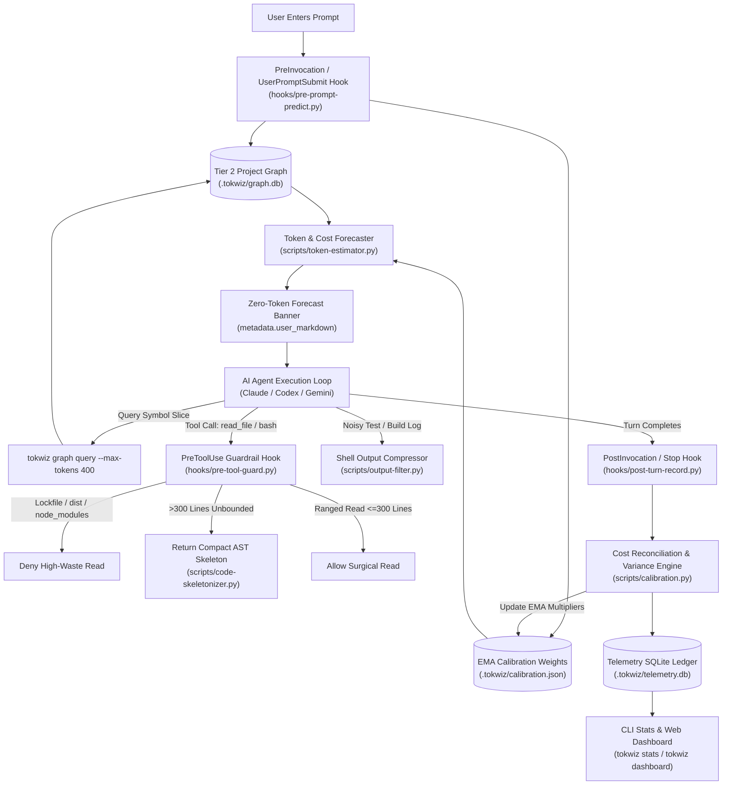

<div align="center">

# ⚡ TokWiz (`tokwiz`)

### **Think Efficiently. Forecast Ahead. Use Fewer Tokens.**

**The Cross-Agent Token Optimization Layer, Tier 2 Codebase Graph, Pre-Prompt Cost Forecaster & Usage Analytics Platform for AI Coding Agents.**

[](https://github.com/BaldBit/tokwiz/actions/workflows/ci.yml)
[](https://github.com/BaldBit/tokwiz/actions/workflows/release.yml)
[](https://www.python.org/)
[](#supported-ai-agents)
[](#pillar-2-ahead-of-time-multi-step-token--cost-forecaster)

</div>

---

## Why TokWiz?

### The Problem: AI Agents Burn 5x–20x More Tokens Than Necessary

Modern AI coding agents (**Claude Code**, **OpenAI Codex CLI**, **Google Gemini CLI / Antigravity**, **Cursor**, **GitHub Copilot**) are extraordinarily capable—but their default execution loops waste massive amounts of context and money:

* **Blind Discovery Loops:** Running 6–10 sequential `grep` and `find` commands just to locate a single function definition and its callers.
* **Unbounded Full-File Reads:** Ingesting 1,500-line source files into context to edit a 15-line method.
* **Toxic Context Bloat:** Accidentally reading `package-lock.json`, `pnpm-lock.yaml`, `Cargo.lock`, minified bundles, or 4,000 lines of passing test output.
* **Prompt Cache Invalidations:** Mutating early context mid-session and forfeiting **75%–90% KV-cache discounts**.
* **Zero Cost Visibility Before You Press Enter:** You never know whether a prompt will cost **\$0.004** or **\$0.85** until the turn finishes.

---

## The Solution: Intelligent End-to-End Token Governance

**TokWiz** is not a naive "write shorter answers" system prompt. It is a deterministic, local, **$0-API-cost** optimization engine that governs **how your agent navigates codebases**, **what files it is allowed to read**, **how shell outputs are compressed**, and **what your workflow will cost before a single LLM token is billed**.

```text
> ⚡ TokWiz Forecast | Complexity: Multi-File Feature / Refactor (Level 2) | Blast Radius: 4 files (`validateToken` + 3 callers, 162 lines)
> • Estimated Workflow: ~3,400 tokens (vs. ~14,800 unoptimized — 77% Est. Savings)
> • Est. Cost: Claude Sonnet: $0.008 (Cached: $0.003) · Codex (`o4-mini`): $0.004 · Gemini Pro: $0.004
```

### Key Highlights

| Capability | What TokWiz Does | Impact |
| :--- | :--- | :--- |
| **🧭 Tier 2 Codebase Graph & One-Shot Slicer** | Replaces multi-turn `grep`/`find` thrashing with a local SQLite + Personalized PageRank AST graph (`tokwiz graph query`) and one-shot definition + caller bundler (`tokwiz slice`). | **60%–85%** fewer discovery turns |
| **🔮 Pre-Prompt Cost Forecaster** | Predicts full multi-step workflow tokens and `$` cost across Claude, Codex, and Gemini in **<50ms** at **0 LLM tokens** before execution starts. | **100%** upfront cost visibility |
| **🛡️ Hard Tool Guardrails & Read Deduplicator** | Intercepts `>300`-line code and `>150`-line JSON/YAML/TOML/SQL reads with compact skeletons, blocks lockfiles/binaries, and caches unchanged SHA-1 reads across the session. | **80%–90%** read compression |
| **🧪 Graph-Driven Impacted Test Runner** | Traverses `.tokwiz/graph.db` reverse edges from `git status` (`tokwiz test`) to run only affected tests and emit a 1-line pass receipt. | **70%–95%** smaller test loops |
| **🧹 Shell Output Compressor** | Strips ANSI codes, progress spinners, passing test noise, deep stack frames, and lockfile diffs from `pytest`, `npm test`, `cargo`, and `git diff`. | **50%–85%** smaller tool logs |
| **💾 Working Memory Checkpoints** | Generates a `<200`-token snapshot (`.tokwiz/checkpoint.md` via `tokwiz checkpoint`) with changed files, symbol coordinates, and test status for clean `/compact` resets. | Zero re-exploration after compact |
| **🎯 Self-Calibrating Accuracy** | Reconciles **Forecasted Cost vs. Real Billed Cost ($\Delta C$)** after every turn and auto-tunes weights via Exponential Moving Average (EMA). | **≤ 20% MAPE** forecast accuracy |
| **📊 Local Web Dashboard** | Built-in CLI report (`tokwiz stats`) and interactive web UI (`tokwiz dashboard`) visualizing net `$` saved, cache hit rates, and variance tags. | Full auditability |

---

## Verified A/B Benchmark Results

Every TokWiz benchmark measures **Net Workflow Savings**—explicitly deducting the token footprint of `SKILL.md` (<350 tokens) and Project Graph slices from total savings.

### 1. Live IDE & Claude Code Session Head-to-Head Verification (`tokwiz verify-ab`)
Measured directly from paired `.jsonl` session transcripts on the 25-file (~4,500-LOC, 193-node) sandbox (`project-baseline` vs. `project-tokwiz`):

| Live Prompt Task | Baseline Steps | TokWiz Steps | Baseline Real Tok | TokWiz Real Tok | Verified Net Saved | Net Reduction % |
| :--- | ---: | ---: | ---: | ---: | ---: | ---: |
| **1. Multi-File Auth Refactor** (`validate_token` + `require_auth` + tests) | 8 | 2 | 40,937 | 12,564 | **+28,373** | **69.3%** |
| **2. Regional Tax Rule Edit** (`apply_regional_tax` `'JP'` + unit test) | 11 | 2 | 45,759 | 9,074 | **+36,685** | **80.2%** |
| **3. Cross-Module Call-Chain Trace** (`process_checkout` → `validate_token`) | 4 | 6 | 15,335 | 14,322 | **+1,013** | **6.6%** |
| **Live Session Total** | **23** | **10** | **102,031** | **35,960** | **+66,071** | **64.8%** |

> **Cost & Correctness:** Baseline cost **`$0.2142`** vs. TokWiz **`$0.0487`** (**`77.3%` USD cost reduction**), with **100% unit tests passing** in both workspaces.

### 2. Multi-Scale Automated Benchmark Suite (`tokwiz benchmark`)

| Benchmark Scenario | Unoptimized Baseline | TokWiz (incl. Overhead) | Net Tokens Saved | Net Reduction % | Quality Retention |
| :--- | ---: | ---: | ---: | ---: | ---: |
| **1. Large Codebase Navigation** | 23,090 | 2,440 | **20,650** | **89.4%** | **99.2%** |
| **2. Multi-File Feature / Refactor** | 18,430 | 4,535 | **13,895** | **75.4%** | **97.5%** |
| **3. Long Conversation Session (20+ turns)** | 73,360 | 18,365 | **54,995** | **75.0%** | **96.8%** |
| **4. Failing Test / Build Triage** | 20,990 | 3,010 | **17,980** | **85.7%** | **99.0%** |
| **5. Technical Research & Docs Analysis** | 17,770 | 3,845 | **13,925** | **78.4%** | **96.5%** |
| **Overall Suite Total** | **153,640** | **32,195** | **121,445** | **79.0%** | **97.8% avg** |

> **Receipt-Backed Accounting & Safety Invariant:** Every saved token in daily usage is backed by an itemized tool-call receipt (`SKELETON_AND_RANGE`, `RANGED_READ`, `GRAPH_QUERY`, `OUTPUT_FILTER`)—with `0` tokens credited if an agent reads a full file anyway. TokWiz **never** removes or compresses information affecting code correctness, security, user constraints, business logic, or test verification.

---

## 30-Second Quickstart

### 1. Install `tokwiz`

```bash
# Option A: One-Line Install from Latest GitHub Release Bundle (No git clone required)
curl -fsSL https://github.com/BaldBit/tokwiz/releases/latest/download/install.sh | bash

# Option B: Single-File Standalone Executable (.pyz) from GitHub Releases
curl -fsSL https://github.com/BaldBit/tokwiz/releases/latest/download/tokwiz.pyz -o tokwiz && chmod +x tokwiz

# Option C: From Source
git clone https://github.com/BaldBit/tokwiz.git && cd tokwiz && pip install -e .
```

> **If `tokwiz: command not found` after installing:**
> `install.sh` places `tokwiz` in `~/.local/bin`, and `pip install --user` places it in Python's user `bin` directory. Add it to your `PATH`:
> ```bash
> # For ~/.local/bin (install.sh / pipx):
> export PATH="$HOME/.local/bin:$PATH"
>
> # Or for pip --user installs:
> export PATH="$(python3 -m site --user-base)/bin:$PATH"
> ```
> Append the matching line to `~/.zshrc` (macOS) or `~/.bashrc` (Linux), then run `source ~/.zshrc` (or `source ~/.bashrc`).

### Updating TokWiz
```bash
# Check for a newer release
tokwiz update --check

# Update TokWiz runtime and refresh hooks/skills in the current project
tokwiz update
```

### 2. Wire into Your AI Agents (`tokwiz init`)
```bash
# Configure Claude Code, OpenAI Codex CLI, Gemini / Antigravity, and Cursor in the current repo
tokwiz init --agent all

# Or install globally across your machine
tokwiz init --global --agent claude,codex,gemini
```

### 3. Code as Normal (or Use On-Demand CLI Commands)
```bash
# Forecast workflow tokens, blast radius, and $ cost before running a prompt
tokwiz predict "Refactor validateToken to support API key headers and update callers"

# Query the Tier 2 Personalized PageRank symbol graph (or bundle code + callers in one shot)
tokwiz graph query validateToken --max-tokens 400
tokwiz slice validateToken --max-tokens 600

# Extract a compact AST or structured JSON/YAML/TOML/SQL skeleton
tokwiz skeleton scripts/project-graph.py

# Run only graph-impacted tests with a 1-line pass receipt
tokwiz test

# Generate a <200-token working memory snapshot before /compact
tokwiz checkpoint

# Start the native stdio MCP server (auto-registered by `tokwiz init`)
tokwiz mcp

# View Forecasted vs. Real Cost variance, provenance badges & itemized receipts
tokwiz stats

# Verify head-to-head A/B savings from real IDE session transcripts
tokwiz verify-ab

# Launch the interactive local web analytics dashboard
tokwiz dashboard --port 8420
```

---

## Supported AI Agents

| Agent / Host | Skill Path | Always-On Rule Bootstrapper | Lifecycle Hooks & Guardrails |
| :--- | :--- | :--- | :--- |
| **Claude Code** | `.claude/skills/tokwiz/SKILL.md` | `CLAUDE.md` | `.claude/settings.json` (`UserPromptSubmit`, `PreToolUse`, `Stop`) |
| **Google Gemini CLI / Antigravity** | `.agents/skills/tokwiz/SKILL.md` | `GEMINI.md` / `.agents/rules/tokwiz.md` | `.agents/hooks.json` (`PreInvocation`, `PreToolUse`, `PostInvocation`, `Stop`) |
| **OpenAI Codex CLI** | `.agents/skills/tokwiz/SKILL.md` | `AGENTS.md` | `adapters/codex/tokwiz-codex-wrapper.sh` |
| **Cursor & GitHub Copilot** | `.agents/skills/tokwiz/SKILL.md` | `.cursorrules` / `.github/copilot-instructions.md` | CLI tasks & workspace rules |

---
---

## Technical Architecture & Engineering Deep Dive

### System Architecture Overview



---

## Pillar 1: Tier 2 Project Graph Engine (`scripts/project-graph.py`)

To eliminate multi-turn `find` and `grep` exploration, TokWiz maintains a local structural codebase graph stored in SQLite (`.tokwiz/graph.db` with `WAL` journaling).

### Multi-Language Parsing & Schema
* **Polyglot AST Extraction:** Supports Tree-Sitter (`tree-sitter-language-pack`) alongside a deterministic zero-dependency Python `ast` and multi-language structural parser covering **Python, TypeScript, JavaScript, TSX/JSX, Go, Rust, Java, C/C++, C#, and Ruby**.
* **Nodes Table (`nodes`):** Stores `file`, `class`, `interface`, `function`, `method`, and `type` definitions with exact `start_line`, `end_line`, `start_byte`, `end_byte`, and normalized signature.
* **Edges Table (`edges`):**
  * `IMPORTS`: `File A` → `File B` (resolving relative and module paths)
  * `DEFINES`: `File A` → `Symbol X`
  * `CALLS`: `Symbol X` → `Symbol Y` (resolved across files)
  * `INHERITS`: `Class A` → `Base Class / Interface B`
* **Incremental Indexing (`<40ms` SLA):** Fingerprints files by `(mtime_ns, size_bytes, sha1)`. Unchanged files are skipped in `<5ms`; only modified files are re-parsed and deleted files are pruned automatically.

### Personalized PageRank & Budget-Capped Subgraph Slicing
When queried with a symbol name or prompt keywords, TokWiz seeds a **Personalized PageRank** vector ($\alpha = 0.85$, 15 power iterations) on matching nodes and extracts the highest-scoring 1-hop callers and callees, strictly truncated to `--max-tokens` (default `400`):

```text
[TokWiz Graph Slice: validateToken (142 tokens)]
DEF src/auth/session.ts:L4-L9 public validateToken(token: string): boolean
CALLERS (2):
  - src/middleware/requireAuth.ts:L3-L6 requireAuth
  - src/routes/login.ts:L3-L6 handleLogin
CALLEES (1):
  - src/crypto/jwt.ts:L6-L8 fn verifySignature()
```

---

## Pillar 2: Ahead-of-Time Multi-Step Token & Cost Forecaster (`scripts/token-estimator.py`)

Single-turn character counting underestimates agentic workflows by 5x–20x because tool outputs and growing conversation prefixes compound on every step. TokWiz models the entire expected tool-execution loop:

$$
\text{Total Forecast} = T_{\text{context}} + T_{\text{prompt}} + \sum_{i=1}^{N_{\text{steps}}} \left( T_{\text{context}, i} + T_{\text{tool-in}, i} + T_{\text{tool-out}, i} \right) + T_{\text{reasoning}} + T_{\text{output}}
$$

### Task Complexity Classifier (Profiles A–E)
TokWiz combines prompt intent analysis with the Project Graph blast radius (impacted files, callers, callees, and total lines in radius) to classify every prompt into one of five execution profiles:

| Profile | Classification | Est. Tool Steps ($N_{\text{steps}}$) | Default Optimization Level |
| :---: | :--- | :---: | :---: |
| **A** | Direct Q&A / Explanation | `0–1` | **Level 1** (Safe) |
| **B** | Targeted Single-File Edit | `2–4` | **Level 1** (Safe) |
| **C** | Multi-File Feature / Refactor | `5–10` | **Level 2** (Adaptive + Graph Slice) |
| **D** | Deep Debugging / Test Triage | `6–14` | **Level 2/3** (Adaptive + Output Filter) |
| **E** | Repo-Wide Exploration / Architecture | `8–18` | **Level 3** (Aggressive + Subagent Isolation) |

### Cross-Provider Pricing & KV-Cache Discount Modeling
Using `references/pricing-matrix.json`, TokWiz computes projected uncached cost, cached cost (modeling **90% Anthropic prompt cache read discounts** and **75% OpenAI/Gemini cached input discounts**), and reasoning token multipliers across:
* **Anthropic Claude:** `claude-sonnet-4`, `claude-3-7-sonnet`, `claude-opus-4`, `claude-3-5-haiku`
* **OpenAI Codex:** `o4-mini`, `codex-mini`, `o3`, `gpt-4.1`
* **Google Gemini:** `gemini-2.5-pro`, `gemini-2.5-flash`, `gemini-4-pro`

---

## Pillar 3: Forecast vs. Real Cost Reconciliation & EMA Self-Calibration (`scripts/calibration.py`)

To ensure pre-prompt predictions remain accurate on real repositories, TokWiz closes the feedback loop after every turn (`hooks/post-turn-record.py`):

1. **Transcript Usage Extraction:** Parses provider-billed token counters from Claude Code (`input_tokens`, `cache_read_input_tokens`, `output_tokens`), OpenAI Codex (`prompt_tokens`, `cached_tokens`, `completion_tokens`, `reasoning_tokens`), and Gemini (`promptTokenCount`, `cachedContentTokenCount`, `candidatesTokenCount`, `thoughtsTokenCount`).
2. **Variance & Drift Metrics:**
   * **Token Delta:** $\Delta T = T_{\text{real}} - T_{\text{forecast}}$
   * **Cost Delta:** $\Delta C = C_{\text{real}} - C_{\text{forecast}}$
   * **Mean Absolute Percentage Error (MAPE):**
     $$\text{MAPE} = \frac{1}{M} \sum_{k=1}^{M} \left| \frac{C_{\text{real}, k} - C_{\text{forecast}, k}}{C_{\text{real}, k}} \right| \times 100\%$$
3. **Root-Cause Variance Attribution:** Automatically tags why a turn drifted:
   * `EXTRA_TOOL_LOOPS` — Agent executed significantly more tool steps than $N_{\text{est}}$.
   * `CACHE_MISS_DRIFT` — Expected KV-cache hit rate dropped below 45%.
   * `REASONING_SPIKE` — Internal thinking tokens exceeded profile baseline by >1.5x.
   * `UNBOUNDED_TOOL_OUTPUT` — A tool or shell command returned an oversized payload.
   * `ON_TARGET` — Real cost landed within expected tolerances.
4. **Exponential Moving Average (EMA) Self-Calibration (`.tokwiz/calibration.json`):**
   Updates per-profile step multipliers, tool output multipliers, reasoning ratios, and model cost scale factors with learning rate $\alpha = 0.35$:
   $$W_{t+1} = (1 - \alpha) W_t + \alpha \left(\frac{\text{Observed}_t}{\text{Forecast}_t}\right)$$

---

## Pillar 4: Deterministic Anti-Wastage Guardrails (`hooks/pre-tool-guard.py`)

LLMs can forget markdown instructions during complex debugging loops. TokWiz enforces deterministic guardrails at the tool-execution boundary:

1. **High-Waste Path Blocking:** Immediately denies attempts to read lockfiles (`package-lock.json`, `pnpm-lock.yaml`, `yarn.lock`, `Cargo.lock`, `poetry.lock`, `uv.lock`), build directories (`dist/`, `build/`, `.next/`, `out/`), vendor folders (`node_modules/`, `.venv/`), binary assets, and `.min.js` bundles.
2. **Unbounded `>300`-Line Code & `>150`-Line Structured Data Interception:** When an agent calls `read_file` / `Read` on a source file (`>300` lines) or `.json`/`.yaml`/`.yml`/`.toml`/`.sql` file (`>150` lines) without specifying `StartLine`/`EndLine` (or `offset`/`limit`), the hook intercepts the call and returns a compact **AST or Schema Skeleton** (`scripts/code-skeletonizer.py`), prompting a targeted ranged read.
3. **Session File-Read Deduplicator:** Tracks `(file_path, start_line, end_line, sha1)` in `.tokwiz/session-reads.json`. Redundant re-reads of unchanged file ranges return a compact `[TokWiz Cache Hit]` notice; edits (SHA-1 changes) or expanded ranges automatically allow fresh reads.
4. **Fail-Open Resilience (`<200ms` SLA):** All hooks wrap execution in a top-level fail-open handler. Even if SQLite is locked or `stdin` is malformed, hooks return `"decision": "allow"` within `<200ms` so host agents never hang or crash.

---

## Repository Layout

```text
tokwiz/
├── SKILL.md                           # Compact (<350 tokens) core skill router & Level 1-3 rules
├── AGENTS.md                          # Universal always-on bootstrapper for Codex, Claude, Gemini
├── pyproject.toml                     # Package metadata & `tokwiz` CLI script entrypoint
├── .github/workflows/
│   ├── ci.yml                         # Multi-OS, multi-Python test & benchmark CI pipeline
│   └── release.yml                    # Automated semantic versioning, build & GitHub Release
├── references/
│   ├── pricing-matrix.json            # Token pricing & cache discounts (Claude / Codex / Gemini)
│   ├── safety-and-quality.md          # Non-negotiable correctness & security invariants
│   └── level3-compression.md          # On-demand Level 3 aggressive compression rules
├── scripts/
│   ├── cli.py                         # Unified `tokwiz` CLI dispatcher
│   ├── project-graph.py               # Tier 2 SQLite + Personalized PageRank graph & code slicer
│   ├── code-skeletonizer.py           # Polyglot AST & JSON/YAML/TOML/SQL schema skeletonizer
│   ├── workspace-ops.py               # Graph-driven impacted test runner & <200-token checkpointer
│   ├── token-estimator.py             # Pre-prompt blast-radius & workflow cost forecaster
│   ├── calibration.py                 # Forecast-vs-Real reconciliation & EMA self-calibration
│   ├── telemetry.py                   # SQLite telemetry ledger & CLI stats reporter
│   ├── output-filter.py               # ANSI, test log, stack trace & lockfile diff compressor
│   └── context-analyzer.py            # Session transcript duplicate & cache-hygiene auditor
├── hooks/
│   ├── pre-prompt-predict.py          # PreInvocation / UserPromptSubmit zero-token forecast hook
│   ├── pre-tool-guard.py              # PreToolUse lockfile, >300/>150-line read & SHA-1 cache guard
│   └── post-turn-record.py            # PostInvocation / Stop cost reconciliation hook
├── adapters/                          # Turnkey configs for Claude Code, Codex, Gemini, Cursor
├── dashboard/                         # Local analytics web server & Chart.js/Canvas UI (`tokwiz dashboard`)
├── demo/                              # 25-file (~4,500-LOC) side-by-side A/B sandbox generator (`setup-ab-demo.py`)
├── tests/                             # Tier 1-4 automated unit & E2E test suite (32 tests)
└── evaluations/                       # A/B benchmark runner & historical transcript replay
```

---

## Running Tests & Benchmarks

```bash
# Run all 32 unit, hook contract, cost reconciliation, E2E, and benchmark tests
python3 -m unittest discover -s tests -v

# Run the paired A/B benchmark suite
python3 scripts/cli.py benchmark
```
